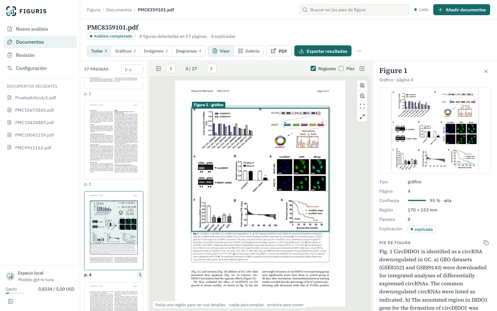
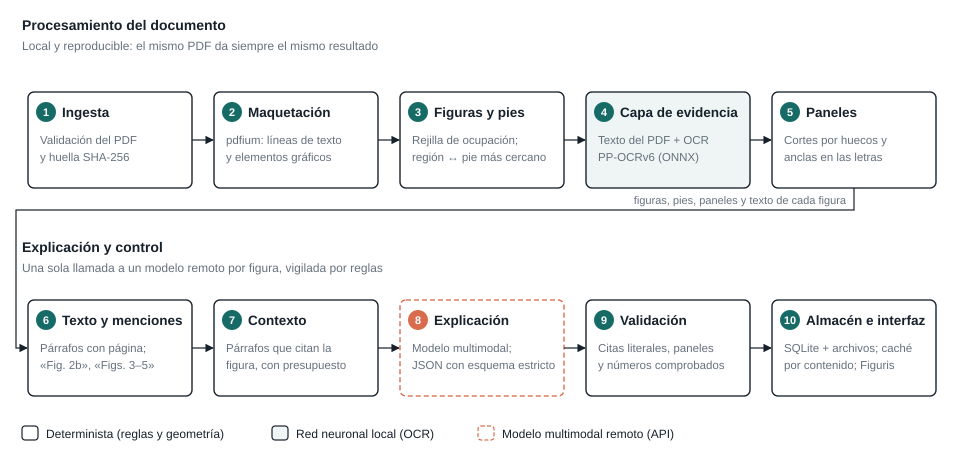
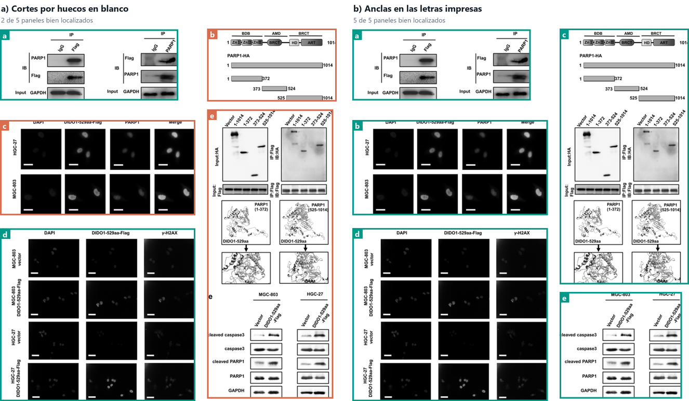
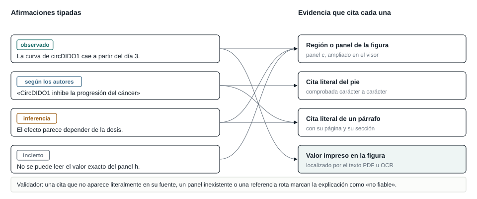
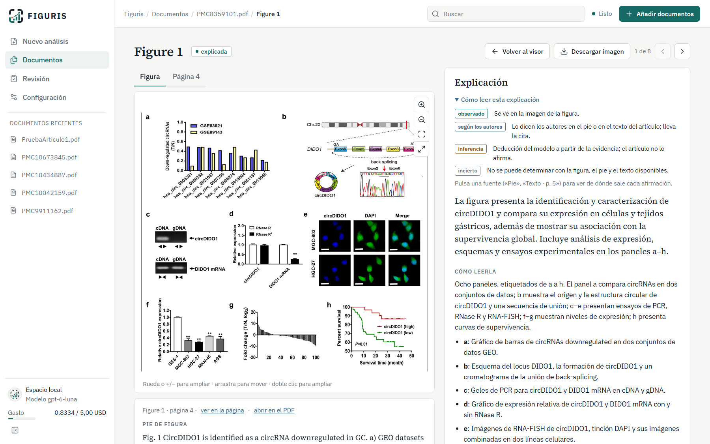
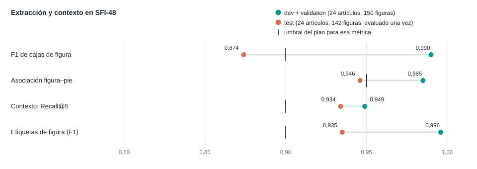
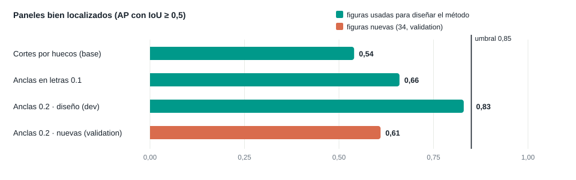
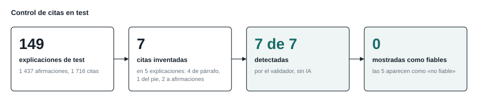

<p align="center">
  
</p>

<h1 align="center">Figuris</h1>
<p align="center"><em>Extracción y explicación verificable de figuras en artículos científicos</em></p>
<p align="center">Proyecto personal · octubre de 2026 · Apache-2.0</p>

---

### Resumen

Los modelos multimodales describen figuras científicas con soltura, pero no dicen de dónde sale lo que afirman y se equivocan con la misma seguridad con la que aciertan. **Figuris** es un sistema local que localiza cada figura de un PDF, la asocia con su pie y con los párrafos que la citan y lee el texto impreso en ella. Solo entonces pide a un modelo multimodal una explicación estructurada en la que cada afirmación declara su tipo y cita su fuente. Un validador sin IA comprueba esas citas antes de mostrarlas. Sobre SFI-48, un corpus propio de 48 artículos y 292 figuras, el conjunto de prueba reservado da un F1 de 0,874 en las cajas de figura. El modelo inventó 7 citas en 149 explicaciones; el validador detectó las siete y ninguna se mostró como fiable. El coste total en llamadas al modelo fue inferior a un dólar.

<p align="center">
  
</p>

**Figura 1.** Espacio de trabajo: páginas con sus figuras marcadas, la página con las regiones detectadas y los detalles de la figura seleccionada. Artículo: Zhang et al., *Mol Cancer* 20:101 (2021), CC BY 4.0.

## 1. Introducción

Pedir a un asistente de IA que «explique la figura 3» es la solución más inmediata, y a menudo funciona. Pero la respuesta mezcla lo que se ve en la imagen, lo que dicen los autores y lo que supone el modelo, y no se puede comprobar sin volver al PDF. Figuris parte de una idea sencilla: **el modelo de lenguaje es una pieza del proceso, no el proceso entero**. Todo lo que puede hacerse sin IA generativa se hace antes: localizar la figura, encontrar su pie, reunir los párrafos que la citan y leer sus números. Después, un validador comprueba que cada cita existe.

Las aportaciones son cuatro:

1. una cadena de extracción local con trazabilidad hasta la región de la página;
2. un esquema de explicación con afirmaciones tipadas y un validador de citas;
3. el corpus de evaluación SFI-48, con anotación humana y un conjunto de prueba congelado;
4. la aplicación web Figuris.

## 2. Sistema

El sistema procesa cada documento en diez etapas (Figura 2). Todo se ejecuta en local salvo la explicación, que hace una llamada al modelo por figura.

<p align="center">
  
</p>

**Figura 2.** Arquitectura. Recuadro blanco: etapa determinista. Sombreado: red neuronal local. Discontinuo: modelo remoto.

- **Figuras y pies.** Con pdfium se leen las líneas de texto y los elementos gráficos de cada página. Los gráficos se proyectan en una rejilla de ocupación donde el texto actúa como muro; sus componentes conexas se asignan al pie más cercano. Tarda unos 40 ms por página. En los escaneados, la rejilla se construye con la tinta de la página.
- **Texto dentro de la figura.** En las figuras vectoriales se toma el texto exacto del PDF. En las rasterizadas se usa OCR: RapidOCR con los modelos **PP-OCRv6**, redes neuronales que se ejecutan en CPU con ONNX Runtime. Lee bien el 89,7 % de los números, así que solo enlaza valores con su posición y nunca invalida nada.
- **Paneles.** El pie se divide en subpies («a) …», «(b) …»). La imagen se corta por los huecos en blanco y, sobre todo, usando como anclas las letras impresas, leídas por el OCR (Figura 3).
- **Contexto.** El texto se reconstruye en párrafos con página y sección. Las menciones («Fig. 2b», «Figs. 3–5») se detectan con expresiones regulares, y al modelo se envían los párrafos que citan la figura.
- **Explicación.** Una llamada a un modelo multimodal (hoy `gpt-6-luna`) con el recorte, el pie y esos párrafos. Devuelve un JSON con esquema estricto (Figura 4).
- **Validación.** Reglas deterministas: cada cita debe aparecer literalmente en su fuente y cada panel citado debe existir. Si algo falla, la explicación se marca como «no fiable».
- **Reproducibilidad.** Cada resultado se guarda con su versión y en una caché por contenido, así que reprocesar no vuelve a pagar. Del equipo solo sale el recorte de cada figura, su pie y los párrafos que la citan.

<p align="center">
  
</p>

**Figura 3.** La misma figura separada por los dos métodos. Verde: panel bien localizado frente a la anotación humana; coral: mal localizado. Los cortes por huecos aciertan 2 de 5 paneles; las anclas en las letras, 5 de 5. Zhang et al. (2021), Fig. 4, CC BY 4.0.

<p align="center">
  
</p>

**Figura 4.** Estructura de una explicación, con ejemplos ilustrativos. Cada afirmación es de uno de cuatro tipos (**observado**, **según los autores**, **inferencia** o **incierto**) y cita su evidencia.

**¿Dónde hay aprendizaje profundo?** Solo en dos sitios: el OCR, que es local, y el modelo multimodal, que es remoto. La extracción, los paneles, el contexto y la validación son geometría y reglas.

<p align="center">
  
</p>

**Figura 5.** Explicación de una figura en la aplicación. Cada cita del texto abre la página original con el párrafo resaltado.

## 3. Evaluación

**SFI-48** reúne 48 artículos de PubMed Central con licencia CC BY, de seis disciplinas, con PDF nativos y seis escaneados, y 292 figuras de referencia revisadas a mano. Se dividió de antemano en `dev` (12 artículos), `validation` (12) y `test` (24). `test` estuvo congelado y se evaluó una sola vez, al final.

<p align="center">
  
</p>

**Figura 6.** Extracción y contexto en desarrollo y en `test`, con el umbral del plan.

| Métrica | `dev` + `validation` | `test` | Umbral |
|---|---:|---:|---:|
| F1 de cajas de figura | 0,990 | 0,874 | 0,90 |
| Asociación figura–pie | 0,985 | 0,946 | 0,95 |
| Recall@5 del contexto | 0,949 | 0,934 | 0,90 |
| Figuras perdidas sin aviso | 0 | 1 | 0 |

La caída en `test` viene de los **artículos escaneados**: en biomedicina, con tres escaneados de cuatro, el F1 de cajas baja a 0,73. En los PDF nativos la extracción se mantiene por encima de 0,9.

<p align="center">
  
</p>

**Figura 7.** Separación de paneles frente a las cajas humanas. Las reglas pasan de 0,54 a 0,83 en las figuras usadas para diseñarlas, pero dan 0,61 en 34 figuras nuevas. Por eso las cajas de panel no se muestran en la aplicación.

<p align="center">
  
</p>

**Figura 8.** Control de citas en `test`. Ninguna cita inventada llegó al lector como fiable. Este control no detecta una afirmación falsa que cite un texto real. Para eso, en `validation`, un juez LLM verificado a mano encontró 3 afirmaciones sin respaldo de 207 (1,45 %).

**Limitaciones.** El corpus es pequeño y lo anotó una sola persona, que no es experta en las disciplinas; la corrección de las explicaciones se midió con un juez LLM y no con expertos. Los escaneados concentran los fallos, los paneles y el OCR no alcanzan sus umbrales, y no se ha probado con usuarios. Detalle en [stage5-gates.md](docs/reports/stage5-gates.md) y [stage5-test.md](docs/reports/stage5-test.md).

## 4. ¿Por qué no preguntar directamente a una IA?

| | Asistente con el PDF | Figuris |
|---|---|---|
| ¿Están todas las figuras? | no se garantiza | inventario explícito; lo que no encuentra, lo avisa |
| ¿De dónde sale cada afirmación? | no se indica | cita su fuente: región, pie, párrafo o valor |
| ¿Distingue dato de opinión? | no | cuatro tipos de afirmación |
| ¿Se comprueban las citas? | no | sí; lo inventado se marca como «no fiable» |
| ¿Cuánto se puede confiar? | desconocido | medido sobre un corpus con prueba reservada |
| ¿Es reproducible? | no | versiones y caché |
| ¿Qué sale del equipo? | el PDF completo | solo cada figura, su pie y sus párrafos |
| Preguntas libres | sí | no |

Un asistente devuelve un texto convincente y deja al lector la tarea de comprobarlo. Figuris trata la respuesta del modelo como una hipótesis: prepara la evidencia sin IA, obliga al modelo a citarla y comprueba las citas sin IA. Cuando el modelo se equivoca, el sistema lo detecta y lo dice.

## Referencias

1. Clark y Divvala. *PDFFigures 2.0*. JCDL, 2016. · 2. Siegel et al. *DeepFigures*. JCDL, 2018, [arXiv:1804.02445](https://arxiv.org/abs/1804.02445). · 3. [GROBID](https://github.com/grobidOrg/grobid). · 4. Docling, [arXiv:2501.17887](https://arxiv.org/abs/2501.17887). · 5. Du et al. *PP-OCR*. 2020, [arXiv:2009.09941](https://arxiv.org/abs/2009.09941); [RapidOCR](https://github.com/RapidAI/RapidOCR). · 6. Nagy y Seth. *Hierarchical representation of optically scanned documents* (XY-cut). ICPR, 1984.

## Instalación y uso

Requiere Python 3.11 o superior.

```bash
python -m venv .venv
.venv/Scripts/pip install -e ".[dev,ocr]"    # Linux/macOS: .venv/bin/pip
sfi serve --open                             # aplicación en http://127.0.0.1:8000
```

La explicación necesita `OPENAI_API_KEY` en `.env` (ver `.env.example`); sin ella, las figuras se extraen pero no se explican. El presupuesto y los límites se fijan en `.env`. `SFI_FIGURE_OCR=off` desactiva el OCR: más rápido, pero sin lectura de valores. También hay línea de comandos (`sfi process`, `sfi list`, `sfi costs`), y los tests se lanzan con `pytest`.

**Más documentación:** [resumen](docs/RESUMEN.md), [arquitectura](docs/ARCHITECTURE.md), [decisiones](docs/decisions/), [plan de evaluación](docs/EVALUATION_PLAN.md), [corpus SFI-48](data/sfi48/README.md), [informes por etapa](docs/reports/) y [licencias](research/license-inventory.md).

**Licencia y atribuciones.** Código y documentación bajo Apache-2.0 ([LICENSE](LICENSE), [NOTICE](NOTICE)). Los artículos del corpus conservan sus licencias (`data/sfi48/manifest.json`). Las capturas muestran figuras de Zhang et al., *Mol Cancer* 20:101 (2021), doi:[10.1186/s12943-021-01390-y](https://doi.org/10.1186/s12943-021-01390-y), [CC BY 4.0](https://creativecommons.org/licenses/by/4.0/). La interfaz incluye IBM Plex Sans y Source Serif 4 (OFL 1.1) y los iconos de Lucide (ISC).
